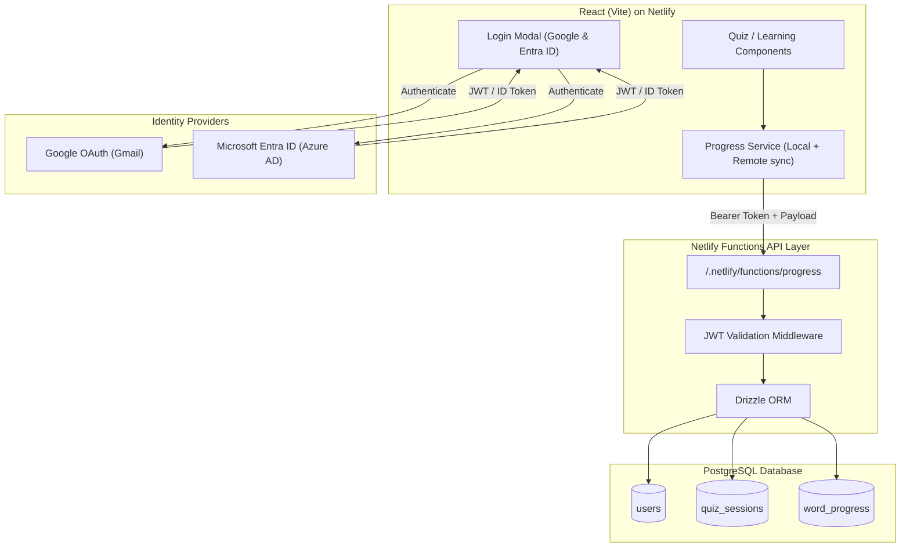

# Full-Stack Architecture Plan: PostgreSQL, OAuth (Google & Entra ID), & API Layer

## 1. Executive Summary
This document outlines the architecture for upgrading **Russian Learning App** into a full-stack, enterprise-grade portfolio project.

The goal is to allow users to optionally authenticate using **Google (Gmail)** or **Microsoft Entra ID (Azure AD)** and securely persist their quiz history, accuracy, and spaced-repetition word progress to a **PostgreSQL** database hosted on a serverless provider (e.g. Supabase or Neon), through a **Netlify Functions** API layer.

---

## 2. Guiding Principles & Non-Breaking Architecture
1. **Zero Downtime / Guest First**: The application remains 100% playable for unauthenticated guest visitors. Progress is stored in local in-memory/`localStorage` state if not logged in.
2. **Serverless & Zero-Cost**: Leverages Netlify's free serverless functions tier alongside Supabase/Neon's free PostgreSQL tier.
3. **Enterprise Security Standards**:
   - OAuth 2.0 / OpenID Connect (OIDC) authentication.
   - JWT validation middleware for protected API routes.
   - Row Level Security (RLS) or user-scoped database isolation.
   - Environment variables for secrets (no hardcoded credentials).

---

## 3. System Architecture Diagram



---

## 4. PostgreSQL Database Schema

```sql
-- 1. Users Table (federated identity)
CREATE TABLE users (
  id UUID PRIMARY KEY DEFAULT gen_random_uuid(),
  auth_provider VARCHAR(50) NOT NULL, -- 'google' | 'entra'
  provider_user_id VARCHAR(255) NOT NULL,
  email VARCHAR(255) NOT NULL UNIQUE,
  display_name VARCHAR(100),
  avatar_url TEXT,
  created_at TIMESTAMPTZ DEFAULT NOW(),
  last_login_at TIMESTAMPTZ DEFAULT NOW(),
  UNIQUE(auth_provider, provider_user_id)
);

-- 2. Quiz Sessions Table (aggregate quiz performance)
CREATE TABLE quiz_sessions (
  id UUID PRIMARY KEY DEFAULT gen_random_uuid(),
  user_id UUID NOT NULL REFERENCES users(id) ON DELETE CASCADE,
  category VARCHAR(50) NOT NULL, -- 'alphabet', 'numbers', 'basicPhrases', etc.
  score INTEGER NOT NULL,
  total_questions INTEGER NOT NULL,
  percentage NUMERIC(5,2) GENERATED ALWAYS AS (ROUND((score::numeric / total_questions) * 100, 2)) STORED,
  completed_at TIMESTAMPTZ DEFAULT NOW()
);
CREATE INDEX idx_quiz_sessions_user_id ON quiz_sessions(user_id);

-- 3. Word Progress Table (spaced repetition / mastery tracking)
CREATE TABLE word_progress (
  id UUID PRIMARY KEY DEFAULT gen_random_uuid(),
  user_id UUID NOT NULL REFERENCES users(id) ON DELETE CASCADE,
  category VARCHAR(50) NOT NULL,
  word_id VARCHAR(100) NOT NULL, -- e.g. 'alphabet-А', 'phrase-hello'
  times_correct INTEGER NOT NULL DEFAULT 0,
  times_incorrect INTEGER NOT NULL DEFAULT 0,
  last_tested_at TIMESTAMPTZ DEFAULT NOW(),
  mastery_level INTEGER NOT NULL DEFAULT 0, -- 0 (new) to 5 (mastered)
  UNIQUE(user_id, word_id)
);
CREATE INDEX idx_word_progress_user_id ON word_progress(user_id);
```

---

## 5. API Contracts (Netlify Functions)

### `GET /.netlify/functions/progress`
* **Headers**: `Authorization: Bearer <jwt>`
* **Response**:
```json
{
  "user": { "id": "...", "email": "...", "displayName": "..." },
  "stats": {
    "totalQuizzesTaken": 14,
    "averageScore": 92.5,
    "wordsMastered": 42
  },
  "recentQuizzes": [...],
  "wordsToReview": [...]
}
```

### `POST /.netlify/functions/progress`
* **Headers**: `Authorization: Bearer <jwt>`
* **Body**:
```json
{
  "quiz": {
    "category": "basicPhrases",
    "score": 9,
    "totalQuestions": 10
  },
  "wordUpdates": [
    { "wordId": "phrase-hello", "category": "basicPhrases", "isCorrect": true },
    { "wordId": "phrase-bye", "category": "basicPhrases", "isCorrect": false }
  ]
}
```

---

## 6. Implementation Roadmap

### Phase 1: Client-Side Service Layer (Zero Breaking Changes)
- [ ] Create `src/types/progress.ts` for unified data models.
- [ ] Implement `src/services/progressService.ts` defaulting to `localStorage`.
- [ ] Connect `Quiz.tsx` to record quiz results via `progressService`.

### Phase 2: Serverless API Scaffolding
- [ ] Set up `netlify/functions/progress.ts`.
- [ ] Implement JWT verification helper (`netlify/functions/utils/auth.ts`).
- [ ] Add Drizzle ORM schema and database connection helper.

### Phase 3: Database & Identity Provider Configuration
- [ ] Provision PostgreSQL instance (Supabase or Neon).
- [ ] Register Google OAuth Client ID & Secret in Google Cloud Console.
- [ ] Register Microsoft Entra ID Application in Azure Portal.
- [ ] Run initial schema migration.

### Phase 4: Frontend UI & Auth Integration
- [ ] Add `AuthModal.tsx` and header `UserMenu.tsx` (Sign in with Google / Entra).
- [ ] On login, merge guest `localStorage` records into PostgreSQL.
- [ ] Add "My Stats / Review Weak Words" view.

---

## 7. Portfolio Value & Talking Points
* **Full-Stack Proficiency**: End-to-end TypeScript from React 18 frontend to serverless Node.js backend.
* **Identity Management**: Enterprise (Entra ID) and consumer (Google) OAuth/OIDC implementation.
* **Database Competency**: Normalized schema, indexed queries, foreign keys, and connection pooling.
* **Cost & Operational Efficiency**: Production-ready, zero-overhead deployment on Netlify + Serverless Postgres.
